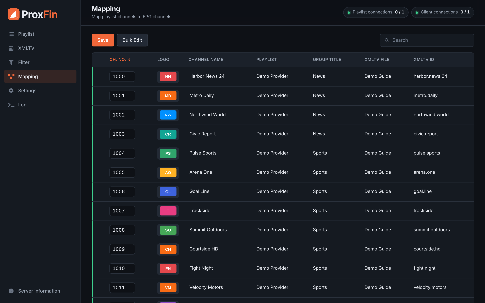
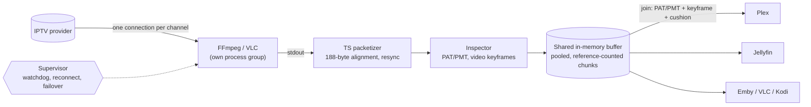
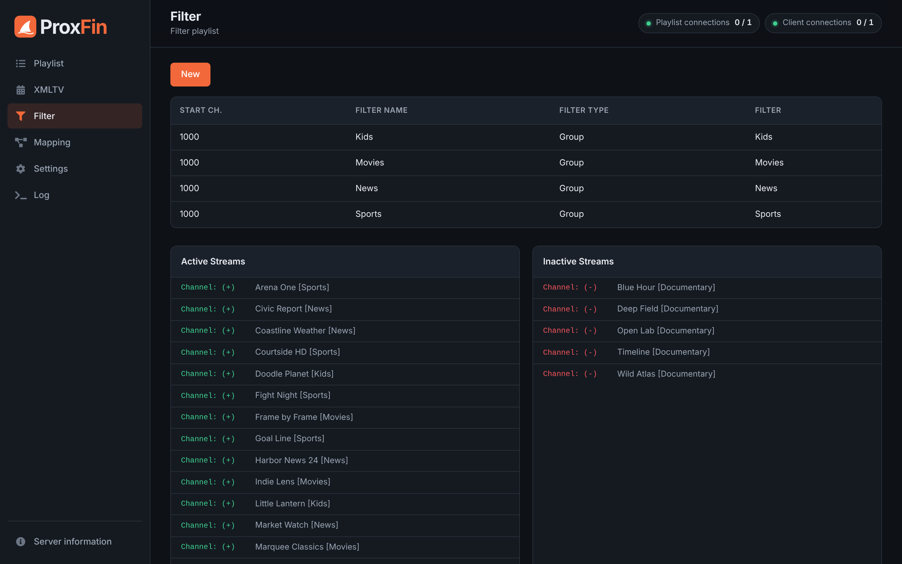
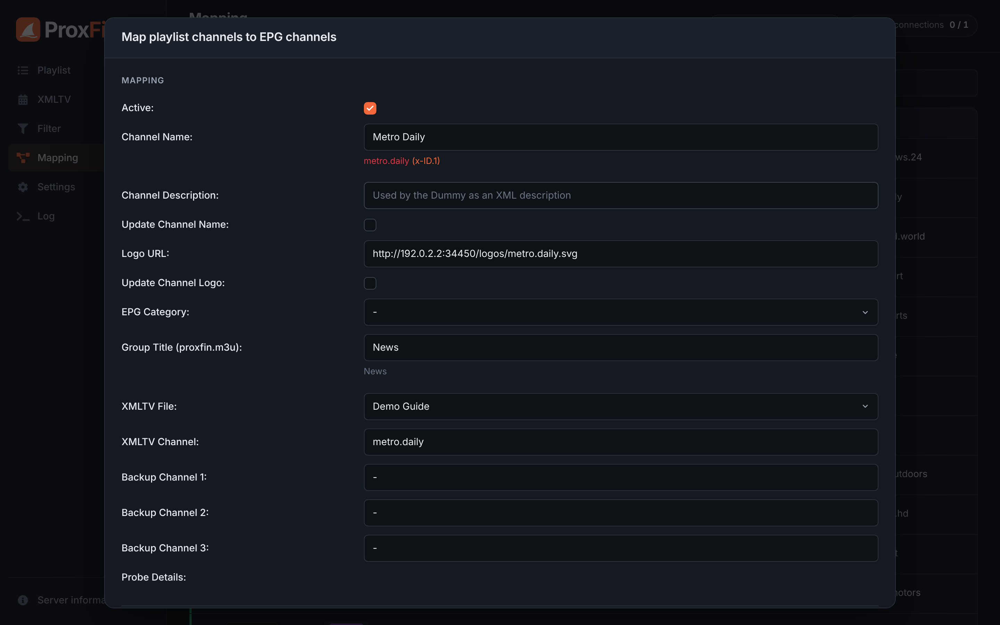
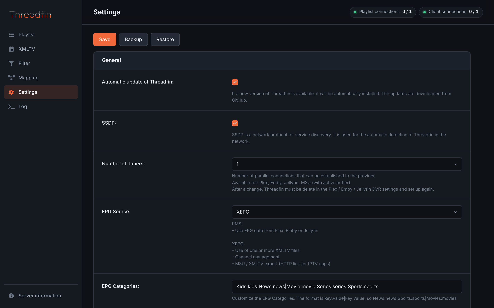
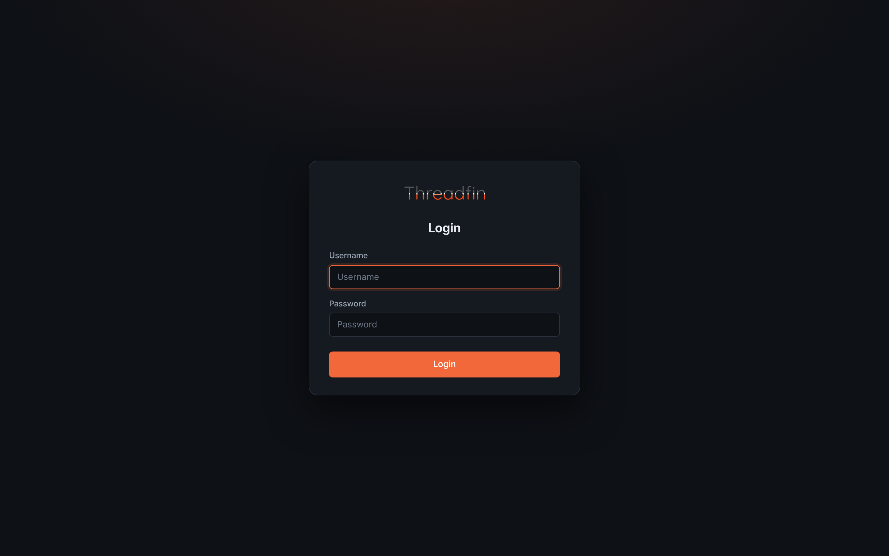
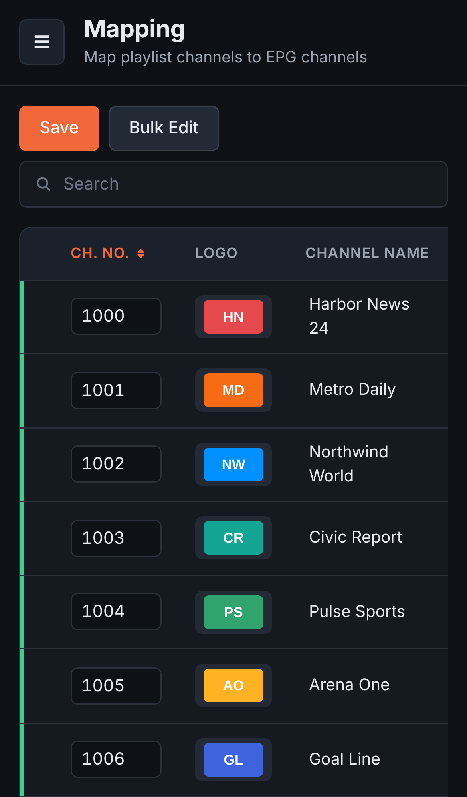
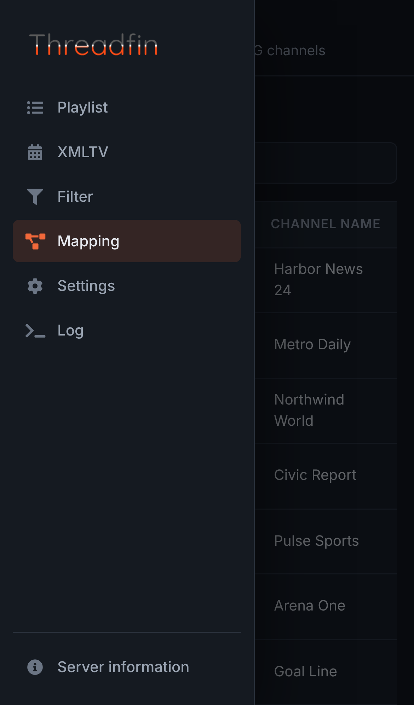

<div align="center">

<picture>
  <source media="(prefers-color-scheme: dark)" srcset="docs/brand/proxfin.png" />
  
</picture>

### M3U proxy for Plex DVR, Emby and Jellyfin Live TV
#### with a stream buffer rebuilt from the ground up


-3ecf8e)

</div>

> **ProxFin is a community rebuild of [Threadfin](https://github.com/Threadfin/Threadfin), which is itself based on [xTeVe](https://github.com/xteve-project/xTeVe).**
> Threadfin and xTeVe did the hard work of making IPTV playlists usable in Plex, Emby and Jellyfin. ProxFin builds on their code, and all credit for the original goes to their authors. See [Credits](#credits).
>
> Coming from Threadfin? Your settings, mappings and DVR setup carry over. See [Switching from Threadfin](#switching-from-threadfin).



---

## Contents

- [What's different](#whats-different)
- [The stream buffer, rebuilt](#the-stream-buffer-rebuilt)
- [A new web interface](#a-new-web-interface)
- [Stability, data safety and security fixes](#stability-data-safety-and-security-fixes)
- [Performance](#performance)
- [Features](#features)
- [Installation](#installation)
- [Switching from Threadfin](#switching-from-threadfin)
- [Development](#development)
- [Known limitations](#known-limitations)
- [Credits](#credits)
- [License](#license)

---

## What's different

ProxFin presents your IPTV playlists and XMLTV guides to Plex, Emby and Jellyfin as a network TV tuner. It started as Threadfin and keeps everything Threadfin does, with three big changes:

1. **The stream buffer was rewritten from scratch.** The old buffer wrote 512 KB segment files to disk and polled them. The new one shares one FFmpeg/VLC process per channel through an in-memory buffer, starts every viewer on a clean keyframe, and survives source dropouts without disconnecting anyone.
2. **The web interface was redesigned.** It has a sidebar app shell, a consistent dark theme and a layout that works on a phone.
3. **The whole codebase was audited** for crashes, leaks, data loss and performance cliffs, and every problem found was fixed with a regression test.

|  | Before | Now |
|---|---|---|
| Stream delivery | 512 KB segment files, polled every 100 ms | Shared in-memory buffer, data delivered as FFmpeg produces it |
| Viewer joining a running channel | Undecodable first frame, 16 decode errors, about 11 s behind live | Starts on a keyframe, first byte after about 1 ms, 0 decode errors |
| Playlists larger than 10 MB | Loaded as **0 channels**, and their mappings were deleted | Parsed correctly |
| First import of 2,000 channels | 52 s | 0.1 s |
| 200 open web UI requests | 92 sockets left open on the server | 0 |
| Automated tests | 1 | **113** plus 11 benchmarks, all run with Go's race detector |

---

## The stream buffer, rebuilt

The buffer is the heart of a tuner proxy: everything a viewer sees goes through it. The original design ran an FFmpeg/VLC process, had it write numbered segment files into a temporary folder, and let every viewer poll that folder. That design caused freezes on failover, stalls that never timed out, races that could crash the process, and viewers joining mid-GOP with corrupt video.

It has been replaced by a new package, [`src/internal/streambuf`](src/internal/streambuf), written for live MPEG-TS.



### How it works

- **One process per channel, shared by every viewer.** Ten people watching the same channel use one upstream connection and one FFmpeg process.
- **Data arrives as it is produced.** Output reaches viewers in pieces of at most 100 ms or 64 KB, instead of in 512 KB segment files. Low-bitrate channels no longer arrive in 2-second lumps.
- **Clean joins.** A viewer joining a running channel gets the PAT/PMT tables first, then starts on a video keyframe, and immediately receives a cushion of buffered video (the *Buffer Size* setting).
  - Keyframes are taken from video PIDs only, because FFmpeg flags every audio packet as random access too.
- **Proper MPEG-TS handling.** Output is cut into whole 188-byte packets, corrupt input is resynchronised, and non-TS output is passed through untouched.
- **Slow viewers can't hurt anyone else.** A viewer that falls 15 s behind is moved to the live position, and the channel and other viewers carry on.

### Reliability

- **Failover without disconnects.**
  - A supervisor loop reconnects a source that was streaming healthily, then tries the backup channels in order. Viewers stay connected throughout.
  - Backups on another playlist use that playlist's tuners, proxy and headers.
- **Short outages are ridden out.** A channel with no backups gets a few reconnect attempts, with growing pauses, before viewers are released.
  - It used to drop everyone about 0.5 s into an outage. It now survives about 5 s, still within a bounded number of attempts.
  - A channel that never started still fails at once.
- **Stalls are detected.** A source that sends nothing for 15 s (20 s at start) is replaced. The old buffer could hang forever on a blocked read.
- **Tuner limits that behave.**
  - A stream keeps running for 5 s after its last viewer leaves, so the probe-then-reconnect pattern Plex uses reuses it.
  - A lingering stream gives up its tuner the moment another channel needs it. Switching channels with a single tuner used to wait 2.0 s and now takes 0.05 s.
  - When every tuner is busy, viewers get the "tuner limit reached" clip.
- **Correct errors.** A channel that cannot start returns `503`, as a real HDHomeRun does, instead of an empty video. Clients that accept no data for 60 s are disconnected so their tuner is freed.
- **One lock, no races.** Streams and tuners are managed under a single mutex: there are no shared maps, no duplicate processes on simultaneous tunes, and no mixed-up channels.

### Process and resource safety

- FFmpeg and VLC run in their own process group, and are always killed together with their children. Their stderr is always drained, and its last lines are logged when a process fails.
- **Graceful shutdown.** On `SIGINT` or `SIGTERM` (Ctrl+C, `docker stop`, systemd) every stream is stopped before ProxFin exits. Previously FFmpeg processes could outlive the program and keep holding provider connections.
- Chunk memory is pooled and reference-counted, so the garbage collector has almost nothing to do: **0 GC cycles in 20 s** under load, against 15 for the old buffer.
- Viewers waiting for the next batch are woken once per batch instead of once per chunk. A channel with 200 viewers uses 2–4× less CPU.
- Write buffers are pooled across connections. A connect-and-leave (Plex probes every channel) allocates 31 KB instead of 289 KB.

### Smarter FFmpeg defaults

- The default options map video and audio as optional (`0:v?`, `0:a:0?`), so radio and video-only channels work. They used to produce no output.
- HTTP(S) sources get FFmpeg's reconnect options, so a dropped connection resumes inside FFmpeg.
  - Only options the installed FFmpeg supports are used.
  - They are never applied to non-HTTP inputs, where they are fatal.
- New installs use `jellyfin-ffmpeg` when it is present, which the Docker image installs.
- Installs still using the old default options are migrated automatically. Custom options are left alone.

### Measured

| Scenario | Old buffer | New buffer |
|---|---|---|
| 20 channels × 5 viewers, 8 Mbps, the proxy's own CPU | 18.6 % of a core | 16.9 % of a core |
| Garbage collections in 20 s under that load | 15 | **0** |
| Viewer joining a running channel (real FFmpeg) | Undecodable first frame, 16 decode errors, about 11 s behind live | First byte after about 1 ms, starts on an I-frame, 0 decode errors |
| Failover to a backup | 3.2 s freeze | Viewers stay connected |
| Source exits or stalls | Response still open 12 s / 30 s later | Detected and handled |

### Tested

The buffer has unit tests for packetizing, PAT/PMT parsing (including real FFmpeg output), joins, failover, stalls, tuner accounting, linger, slow viewers and pooled-memory reuse (with poisoned releases, to catch use-after-free). Integration tests run the real HTTP handler against a fake FFmpeg, and against real FFmpeg with the captured output decoded.

A churn test tunes in and out repeatedly against healthy, dropping, stalling and failing sources. It then checks that goroutines, heap, registered streams and child processes all return to their baseline. A load test is available on request (see [Development](#development)).

---

## A new web interface

<table>
  <tr>
    <td width="50%"></td>
    <td width="50%"></td>
  </tr>
  <tr>
    <td></td>
    <td></td>
  </tr>
</table>

<p align="center">
  
  &nbsp;&nbsp;
  
</p>

- **App shell:** a sidebar with icons and an active state, plus a sticky top bar showing the page title, a description, and live playlist and client connection counters.
- **Dark theme:** one consistent colour system, with clear primary actions, focus rings and custom checkboxes.
- **Data tables:** headers stay visible while you scroll, channel logos are proper thumbnails, the EPG status shows on every row, and inactive channels have their own section.
- **Settings:** grouped into cards. The log is a scrollable console. Dialogs are clean, and the server information page has copy buttons.
- **Login, first-user and setup-wizard pages:** redesigned as centred cards.
- **Works on phones:** the menu slides out and wide tables scroll sideways.
- **Opens on the Playlist page** instead of an empty screen.

---

## Stability, data safety and security fixes

Every item below was found in a full review of the codebase. Each fix comes with a test, and each test was confirmed to fail on the old code.

### Crashes that took the whole process down

Go cannot recover from a concurrent map write, so each of these killed the whole process and every stream with it.

- **Overlapping logins:** Plex fetching `/lineup.json` while another client fetched `/xmltv/` was enough. The authentication maps are now locked.
- **A tune during a playlist refresh:** the refresh runs at 00:00 by default, when recordings often start. Provider settings are now guarded by a read/write lock.
- **A scheduled refresh overlapping "Update" in the web UI**, or an API update call. Refreshes are now serialised.
- **The update check:** a missing or unparseable release (for example a fork with no releases) dereferenced a nil version. This happened at startup, so the program never started, or at the daily update time.
- **Malformed HDHomeRun tuner data** in the maintenance goroutine.

### Data loss

- **Playlists over 10 MB loaded as zero channels.** A second "optimized" parser dropped every entry. The empty result was saved over the playlist and the cleanup deleted all of its channel mappings. There is now one parser for every size, with its patterns compiled once.
- **One unreadable playlist silently dropped the next one,** whose mappings were then deleted, and loaded the last one twice.
- **The PPV endpoints could overwrite `xepg.json` with `null`,** wiping every channel mapping.
- **A crash or power loss while saving could leave `settings.json` empty,** and the program would not start again.
  - Settings, mappings, the user database, playlists and guides are now written to a temporary file and renamed into place.
- **The compressed guide (`.xml.gz`) was always missing up to its last megabyte,** including `</tv>`.
- **The served playlist and guide could be fetched half-written** during a rebuild. They are now replaced atomically.
- **Backups:**
  - A missing file ended the backup early but reported success.
  - Errors from a full disk were ignored.
  - Restores held a file handle per archive entry.

### Leaks and stalls

- **Web UI websockets were never closed,** by either side. The UI opens one per request, every 10 seconds for the log. 200 requests left 92 sockets open on the server; now none are left.
- **Every JSON save leaked a file descriptor.** This happened once per new channel in PMS mode.
- **The image cache stalled playlists:**
  - It downloaded every logo while holding a lock, with no timeout.
  - It kept every socket and file open until the queue finished.
  - One unresponsive image host blocked `/m3u/` and the guide build until a restart.
- **Login tokens never expired from memory,** so every authenticated request added one.
- **The HTTP server had no timeouts:** slow or idle clients held a connection forever. The web UI websocket now also has a message size limit and a read deadline.
- **Update requests had no timeout.** They run before the web server starts and inside the scheduler.
- **The web log** dropped every other message once full, could wipe itself, and was written by many goroutines without a real lock.
- **A failed filter load left a scan flag set,** silently turning off scheduled updates until a restart.
- **A dummy guide length of 0** (`0_Minutes`) looped forever.

### Security hardening

- **Other websites can no longer control ProxFin.** The web interface's websocket accepted connections from any origin. With web authentication off (the default), any page opened by someone on your network could make their browser change its settings, including the FFmpeg path and options, which means running commands on the server.
  - Requests that change something (the websocket, the API, the PPV endpoints, logins) are now refused when a browser sends them for another website. This uses the browser's `Sec-Fetch-Site` header, or the `Origin` header on older browsers.
  - It works behind reverse proxies, through `X-Forwarded-Host` or the configured domain.
  - Plex, Emby, Jellyfin, curl and scripts are not affected.
- **Password hashes and salts are no longer sent to the web interface.**
- **Backup restore rejects archive entries that escape the target folder** (zip slip).
- **Uploaded logo file names can no longer write outside the upload folder** (path traversal).
- **A malformed Basic-auth header** no longer panics the request handler.

### Operations

- Fatal startup errors and crashes exit with code `1`, so systemd's `Restart=on-failure` and Docker restart policies work. They used to exit `0`.
- SSDP announces a goodbye on shutdown, and no longer starts a second advertiser after a restore.
- `/xmltv/` streams the guide from disk instead of holding four copies of it in memory per request. It also answers range and conditional requests.
- An `/m3u/` request with query parameters (such as `username` and `password`) but no `group-title` used to return an empty playlist. It now returns the full one.

---

## Performance

Measured on the code before and after each change.

| Operation | Before | After |
|---|---|---|
| First import, 2,000 new channels (20,000 filtered out) | 52.1 s | 0.10 s |
| Assigning 4,000 new channel numbers | 6.3 s | 1.3 ms |
| Assigning 20,000 new XEPG IDs | 19.4 s | 6.5 ms |
| PMS mode `/lineup.json` with new channels | 104 s for 2,000 | 0.11 s for 20,000 |
| Filtering 5,000 streams through 20 filters | 704 ms | 1.9 ms |
| Guide data for 200 channels, 50,000 programmes | 580 ms | 21 ms |
| Parsing a 200,000-channel playlist | 2.56 s, 1.5 GB allocated | 1.34 s, 0.43 GB allocated |
| Checking a 112 MB XMLTV download, peak heap | +460 MB | +194 MB |
| Building a 20,000-channel group playlist | 4.6 s | 1.0 s |
| `/xmltv/` memory per request, 48 MB guide | 192 MB | streamed |
| CPU, one channel with 200 viewers | 1.8–2.2 s per 3 s | 0.4 s per 3 s |

---

## Features

Everything from Threadfin and xTeVe is still here.

**Files**
- Merge multiple M3U playlists, HDHomeRun tuners and XMLTV guides
- Automatic scheduled updates, with backups before each update
- M3U and XMLTV export, plus a filtered M3U per group (`?group-title=News,Sports`)

**Channel management**
- Filter streams by group or by custom rules (include/exclude, case sensitivity), with a starting channel number per filter group
- Channel mapping with a live preview, bulk edit (Shift to multi-select, renumber from a starting number), and a separate table for inactive channels
- Up to 3 backup channels per channel
- Channel logos, EPG categories, and dummy guides including PPV channels mapped by name

**Streaming**
- FFmpeg or VLC buffer, or direct redirect, with HLS / M3U8 support
- Tuner count per playlist
- Compatible with the Plex, Emby and Jellyfin EPG

### Requirements

| Client | Version |
|---|---|
| Plex | Plex Media Server 1.11.1.4730 or newer, a client with DVR support, and Plex Pass |
| Emby | Emby Server 3.5.3.0 or newer, a client with Live TV support, and Emby Premiere |
| Jellyfin | Jellyfin Server 10.7.1 or newer, and a client with Live TV support |

---

## Installation

> [!IMPORTANT]
> There are no published ProxFin images or release binaries yet. Build from this repository. The `fyb3roptik/threadfin` image on Docker Hub is upstream Threadfin, not ProxFin.
>
> Automatic updates are off until ProxFin publishes releases, so the *Automatic update* setting has no effect yet (see [Releases and updates](#releases-and-updates)).

### Docker

```bash
docker build -t proxfin .
```

For NVIDIA hardware transcoding:

```bash
docker build --build-arg USE_NVIDIA=1 -t proxfin:nvidia .
```

`docker-compose.yml`:

```yaml
services:
  proxfin:
    build: .
    image: proxfin
    container_name: proxfin
    ports:
      - 34400:34400
    environment:
      - TZ=America/Los_Angeles
    volumes:
      - ./data/conf:/home/proxfin/conf
      - ./data/temp:/tmp/proxfin:rw
    restart: unless-stopped
```

The image includes FFmpeg (`jellyfin-ffmpeg` where available) and VLC. Open `http://<host>:34400/web/`.

### From source

Requires [Go](https://go.dev) 1.22 or newer.

```bash
go build -mod=mod -o proxfin .
```

```bash
./proxfin -port 34400
```

| Flag | Description |
|---|---|
| `-port` | Web server port (default `34400`) |
| `-config` | Configuration folder (default `~/.proxfin/`, or an existing `~/.threadfin/`) |
| `-bind` | IP address to bind to |
| `-restore` | Restore a backup: `-restore /path/proxfin_backup.zip` (Threadfin backups work too) |
| `-debug` | Debug level `0`–`3` |
| `-info` | Show system information and exit |
| `-dev` | Developer mode: serve the web interface from `html/` and regenerate the embedded copy |
| `-branch` | Git branch used by the updater |

ProxFin stops its streams and exits cleanly on `SIGINT` or `SIGTERM`.

| | URL |
|---|---|
| Web interface | `http://<host>:34400/web/` |
| Playlist for Emby / Jellyfin | `http://<host>:34400/m3u/proxfin.m3u` |
| Guide | `http://<host>:34400/xmltv/proxfin.xml` (or `.xml.gz`) |
| Plex | Add `<host>:34400` as an HDHomeRun tuner |

---

## Switching from Threadfin

ProxFin is designed so an existing Threadfin install can switch without setting anything up again. Make a backup first (Settings → Backup) so you can go back.

- **Your settings folder is used as it is.**
  - Without `-config`, ProxFin uses `~/.threadfin/` when there is no `~/.proxfin/` yet.
  - In Docker, keep mounting your volume at `/home/threadfin/conf`, and the container uses it.
  - `THREADFIN_*` variables in your compose file (port, bind address, debug level, config folder) still apply.
- **Playlists, guides, filters, mappings and users are kept.** The keys stored in `settings.json` and `xepg.json` are unchanged.
  - Channels mapped to "Threadfin Dummy" are converted to "ProxFin Dummy" automatically.
  - Channels without a `tvg-id` keep their generated `threadfin-…` ids, so their mappings and client guides stay matched.
- **Plex, Emby and Jellyfin keep working.**
  - The tuner keeps its device ID, and only its displayed name changes to ProxFin.
  - The old URLs `/m3u/threadfin.m3u` and `/xmltv/threadfin.xml(.gz)` are still served. You can switch your clients to the `proxfin.*` URLs whenever you like.
- **FFmpeg options still set to the old default are migrated** to the new default. Custom options are not touched. Playlists set to the removed "Threadfin" buffer use FFmpeg.
- **Threadfin backups can be restored.** New backups are named `proxfin_backup_…zip` and `proxfin_auto_backup_…zip`. Old automatic backups are left where they are.

---

## Development

### Layout

| Path | Contents |
|---|---|
| `src/internal/streambuf/` | The stream buffer: sessions, tuners, ring buffer, TS packetizer and inspector, memory pool |
| `src/buffer*.go` | The buffer's HTTP side: tuning, FFmpeg/VLC processes, the tuner-limit clip |
| `src/internal/m3u-parser/` | M3U playlist parser |
| `src/xepg.go`, `src/data.go`, `src/m3u.go` | Playlist, guide and channel-database pipeline |
| `src/webserver.go` | HTTP endpoints and the web UI websocket |
| `ts/`, `html/` | Web interface (TypeScript sources and the compiled site) |
| `src/webUI.go` | Generated copy of `html/` embedded in the binary |

### Web interface

The TypeScript in `ts/` compiles to `html/js/`:

```bash
cd ts && tsc -p tsconfig.json --strict false --alwaysStrict false
```

The flags keep the output identical to the committed JavaScript with TypeScript 6. Release builds serve an embedded copy of `html/` from `src/webUI.go`. Regenerate it by starting a build once in developer mode:

```bash
go build -mod=mod -o proxfin . && ./proxfin -dev
```

### Tests

```bash
go test -mod=mod -race ./...
```

- The buffer's integration tests start real processes, using a fake FFmpeg shell script. `-short` skips them.
- The load test drives real 8 Mbps FFmpeg streams through the buffer with `curl` viewers, and reports ProxFin's CPU usage:

```bash
PROXFIN_LOAD_TEST=1 CHANNELS=20 VIEWERS=5 SECONDS=20 go test -mod=mod ./src/ -run TestBufferLoad -v -timeout 10m
```

- Benchmarks:

```bash
go test -mod=mod -run '^$' -bench . ./src/internal/streambuf/ ./src/
```

The `vendor/` folder is out of date, which is why `-mod=mod` is needed.

### Releases and updates

- **Release builds.** Pushing a version tag such as `2.0.0` runs [`.github/workflows/release.yml`](.github/workflows/release.yml). It builds the binaries (`ProxFin_<os>_<arch>`, the names the updater downloads), pushes Docker images to `<DOCKERHUB_USERNAME>/proxfin`, and creates a GitHub release.
- **Updates.** Automatic updates download those releases from the repository named by the `GitHub` variable in [`proxfin.go`](proxfin.go), which is `TheEngineer808/ProxFin`. They stay off (`Update: false`) until releases exist.
- **Forks** should point the variable at their own repository.
- **Guard test.** `proxfin_test.go` fails if updates are switched on while the variable points at upstream Threadfin, whose releases would replace ProxFin.

---

## Known limitations

These were found in the review and are not fixed yet:

- **Don't expose port 34400 to the internet,** and enable *Web Authentication* if others can reach it. Cross-site requests are refused, but with authentication off anyone who can open the web interface can change settings.
- **Memory:** the parsed guide is kept in memory, at about 2.4× the size of the XMLTV files. A streaming guide writer is planned.
- **Updating one playlist from the web interface refreshes every playlist and guide.**
- **No global memory limit for stream buffers:** each channel holds up to 48 MB or 15 s.
- **On Windows, stopping a stream kills FFmpeg/VLC but not processes they started themselves.**

---

## Credits

This project would not exist without:

- **[Threadfin](https://github.com/Threadfin/Threadfin)** by [Fyb3roptik](https://github.com/Fyb3roptik) and contributors. It is the codebase this project is built on: the Bootstrap UI, backup channels, filter-group channel numbers, the mapping editor improvements, and years of fixes.
- **[xTeVe](https://github.com/xteve-project/xTeVe)**, the original M3U proxy that Threadfin was based on. Its [documentation](https://github.com/xteve-project/xTeVe-Documentation/blob/master/en/configuration.md) is still the best guide to configuration.

Please report problems with ProxFin [here](https://github.com/TheEngineer808/ProxFin/issues), not to the Threadfin or xTeVe projects.

It also uses:
- [go-ssdp](https://github.com/koron/go-ssdp)
- [gorilla/websocket](https://github.com/gorilla/websocket)
- [go-version](https://github.com/hashicorp/go-version)
- [osext](https://github.com/kardianos/osext)
- [avfs](https://github.com/avfs/avfs)
- [Bootstrap](https://getbootstrap.com)
- [Font Awesome](https://fontawesome.com)
- [clipboard.js](https://clipboardjs.com)
- [FFmpeg](https://ffmpeg.org) and [VLC](https://www.videolan.org)

## License

[MIT](LICENSE). [`LICENSE`](LICENSE) keeps the copyright notices of xTeVe, Threadfin and ProxFin, and they must stay with any copy or redistribution.
